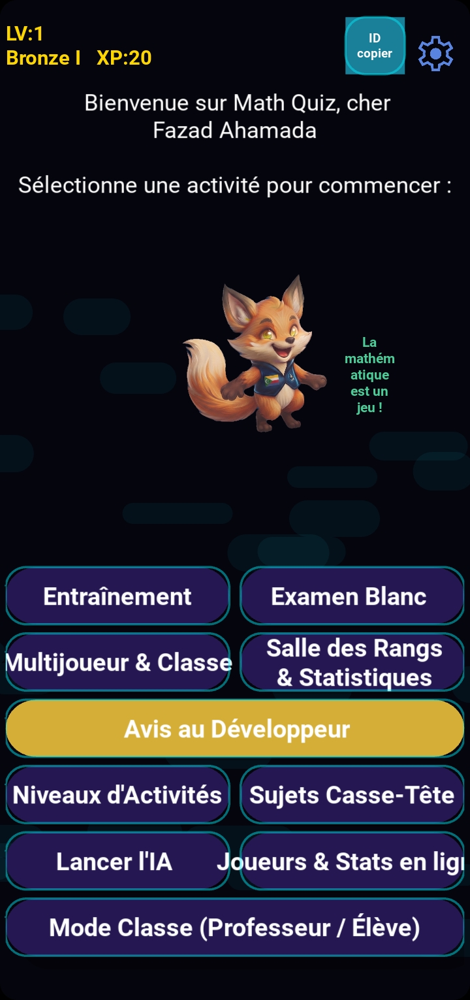
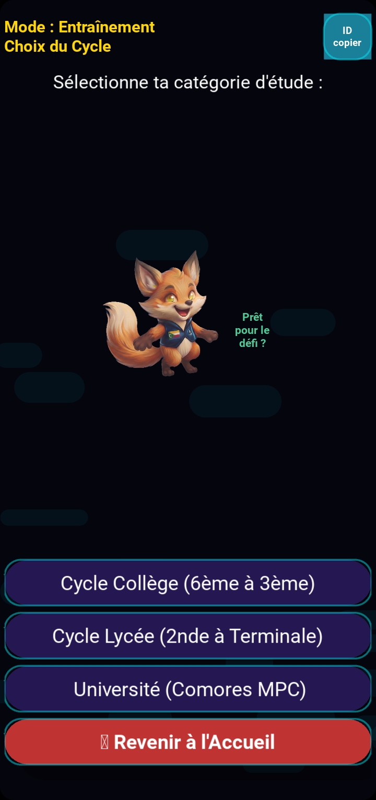
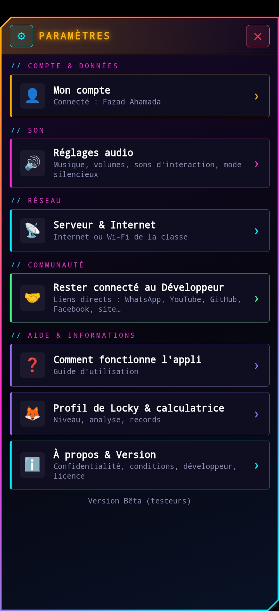
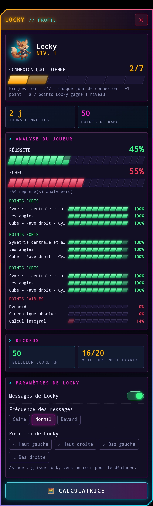
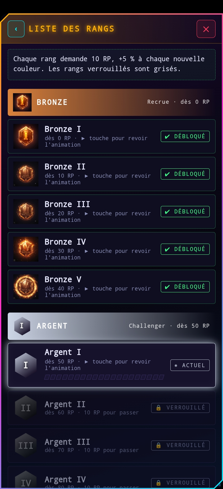
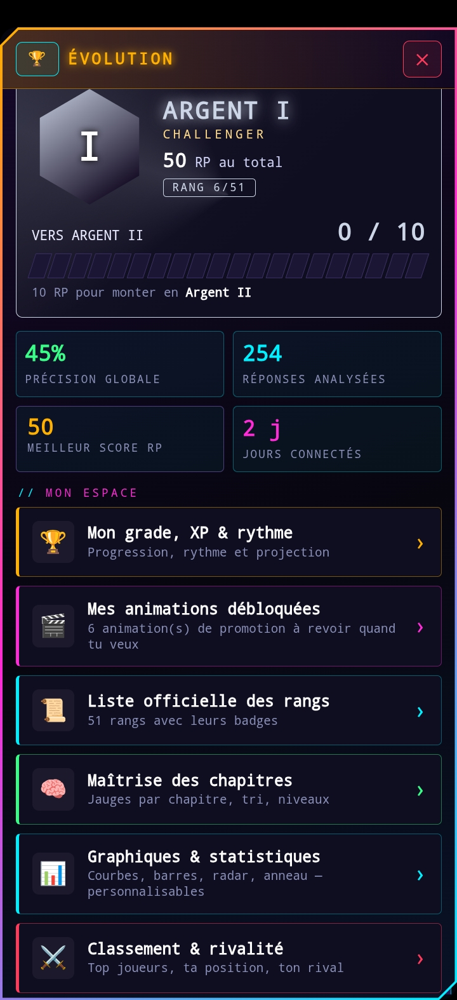
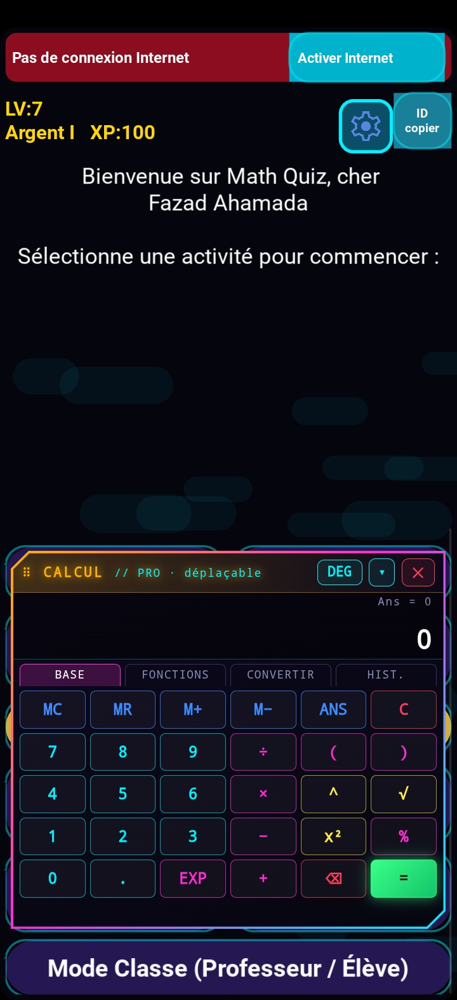

# 🧮 Math Quiz Comores

> **Une application mobile Android éducative et interactive conçue pour accompagner les élèves et étudiants comoriens dans l'apprentissage et la maîtrise des mathématiques.**


---

## 🌟 Présentation du Projet

**Math Quiz Comores** est une application Android développée en **Python** avec le framework **Kivy**. Elle propose une expérience d'apprentissage dynamique grâce à un rendu formel d'équations mathématiques, un système de progression motivant, un mode multijoueur et un assistant intelligent.

L'application couvre les programmes du **Collège (6ème à 3ème)**, du **Lycée (2nde à Terminale)** et de l'**Université (L1 MPC)**.

---

## ✨ Fonctionnalités Clés

* 📐 **Rendu Mathématique Précis :** Affichage d'équations, de fractions, de racines et d'intégrales grâce à l'intégration de **KaTeX** (fonctionne aussi hors-ligne).
* 🏆 **Progression & Classement :** Système de rang compétitif (du Bronze à Légende), suivi de l'XP et statistiques détaillées par chapitre.
* 🎓 **Modes d'Apprentissage :** 
  * *Entraînement libre* avec chronomètre.
  * *Examen Blanc* (10 ou 20 questions notées sur 20).
  * *Niveaux d'Activités* (16 défis progressifs).
* 👥 **Multijoueur & Mode Classe :** 
  * *Même téléphone* (2 à 4 joueurs).
  * *Salles en ligne* (affrontez des amis avec un code).
  * *Mode Classe* (le professeur crée une session, les élèves rejoignent avec un code PIN).
* 🤖 **Mascotte Interactive (Locky) :** Un compagnon virtuel (menu "dark web", calculatrice scientifique intégrée) pour guider et encourager l'utilisateur.
* 🌐 **Assistant IA (Gemini) :** Génération de questions à la volée et discussion de suivi pour aider à la compréhension.

---

## 🛠️ Stack Technique

* **Langage principal :** Python 3
* **Framework GUI Mobile :** Kivy
* **Rendu Mathématique :** HTML / KaTeX (WebView native)
* **API Backend :** Flask & SQLite (Hébergé sur PythonAnywhere)
* **IA :** Google Gemini API
* **Compilation & Distribution :** Buildozer & GitHub Actions (`arm64-v8a`)

---

## 📸 Aperçu de l'Application

| Menu Principal | Choix de la classe | Paramètres |
| :---: | :---: | :---: |
|  |  |  |

| Suivi du joueur | Mascotte Locky | Système de Rang |
| :---: | :---: | :---: |
|  |  |  |

| Évolution | Calculatrice | Quiz en cours |
| :---: | :---: | :---: |
|  |  |  |

---

## 📲 Téléchargement & Installation

Pour tester la dernière version de l'application sur ton smartphone Android :

1. Rends-toi dans la section [**Releases**](../../releases/latest) du dépôt.
2. Télécharge le fichier `.apk` le plus récent (ex: `quizapp_comores-v306-signed.apk`).
3. Installe-le sur ton appareil (autorise l'installation depuis des sources inconnues si demandé).
4. Connecte-toi ou crée ton compte pour sauvegarder ta progression !

---

## ⚙️ Compilation depuis les sources

Si tu souhaites exécuter ou compiler le projet localement :

### Prérequis
* Python 3.10+
* Environnement virtuel (PC) ou Pydroid 3 (Android)
* Buildozer (pour la compilation APK)

### Lancement direct sur PC
```bash
# 1. Cloner le dépôt
git clone https://github.com/fazad-colab/MonQuizKivy.git
cd MonQuizKivy

# 2. Installer les dépendances
pip install -r requirements.txt

# 3. Lancer l'application
python main.py
```
🇰🇲 Auteur & Vision

Projet conçu et développé par Fazad Nassur (Moroni, Comores).

· 🌐 Site web : Omnimath
· 💬 Communauté WhatsApp : Rejoindre le groupe
· 🎥 YouTube : @Omnimath.14

Objectif : Démocratiser l'excellence scientifique par le numérique, offrir des outils modernes et adaptés aux réalités locales, et promouvoir l'innovation technologique aux Comores.


<p align="center">
  <i>© 2026 Fazad Nassur / Omnimath. Tous droits réservés.</i>
</p>
